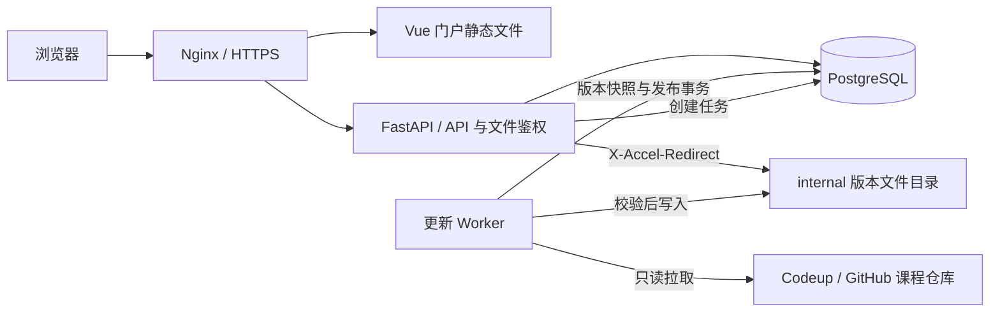

# courseware-dev 整体架构

状态：架构约定，首版已实现；已交付功能与尚未接入的自动化见[开发与交付说明](development.md)。课程数据契约见[课程仓库标准](../apps/courseware-skill/references/course-repository-standard.md)，表结构与接口见[数据与 API](data-and-api.md)。

## 1. 目标与边界

`courseware-dev` 是课程平台的开发统筹仓库，保存跨仓库架构、接口约定、集成验收与部署配置。`apps/` 下的 web、api、skill、demo 各自是独立 Git 仓库，分别提交和发布。每个业务课程仓库独立维护教学页面、资源和 `course.json`。

第一版完成：多用户登录、课程目录与详情、课程/课时检索、制作人和章节展示、权限控制、管理员接入课程、同步入库、静态课程发布及回退。课程无需调用门户 API 即可完成教学交互。

暂不包含在线编辑课件、作业评分、支付、跨设备学习进度、开放注册、第三方 SSO、公开搜索 API。数据模型允许后续扩展，但不预先搭建这些系统。

## 2. 技术选择

| 层 | 建议方案 | 原因 |
| --- | --- | --- |
| 门户前端 | Vue 3 + TypeScript + Vite + Vue Router | 实现登录、目录、检索、详情及管理页面；与静态课程独立 |
| API | Python + FastAPI + Pydantic | 统一会话、权限、查询和导入校验，适合文件处理及现有 Python 环境 |
| 数据访问 | SQLAlchemy + Alembic | 显式事务、关系约束、可追踪数据库迁移 |
| 数据库 | PostgreSQL | 用户、课程元数据、发布状态和任务持久化；支持关系查询和初期检索 |
| 更新执行 | 与 API 共享 Python 模块的独立 Worker 进程 | 拉取仓库和文件校验不阻塞 Web 请求 |
| HTTP 与文件服务 | Nginx + 后端授权 + internal 文件目录 | Python 决定访问权限，Nginx 发送大文件、Range 与 HEAD 响应 |
| 部署 | 单机 Docker Compose | 管理 web/API、Worker、数据库与持久卷；初期不引入集群 |

首版不引入 Redis、消息中间件或专用搜索服务。Worker 使用 PostgreSQL 任务表；API 进程不承担长时间更新工作。生产构建使用锁文件，具体受支持版本在开发启动时固定。

## 3. 请求与发布链路



前后端逻辑分离，生产同源部署，避免不必要的跨域会话复杂度：

| 路径 | 职责 |
| --- | --- |
| `/login` | 门户登录页 |
| `/`、`/catalog`、`/catalog/:slug` | 课程目录、搜索和详情 |
| `/admin/*` | 用户、课程源、权限和发布任务管理 |
| `/api/v1/*` | 门户数据与管理接口 |
| `/courses/:slug/` | 检查权限后跳转当前版本的课程入口 |
| `/courses/:slug/lessons/:lesson_id/` | 检查权限后按稳定课时 ID 跳转当前入口 |
| `/courses/:slug/releases/:release_id/*` | 指定版本的受保护课程页面、图片、字体与下载文件 |

无版本旧文件路径 `/courses/:slug/web/index.html` 等仅作兼容跳转，禁止直接映射到正在修改的目录。课程路由与 API 路由不能落入 SPA 的 `index.html` fallback。课时入口不得占用 `lessons/<id>/` 这个门户跳转地址；实际课程文件都在版本前缀下。

## 4. 仓库与部署目录

仓库职责如下。首版后端以 auth.py、catalog.py、publishing.py 等模块组织，避免尚无必要的目录层级；数据模型统一在 models.py。

```text
courseware-dev/
  apps/                          # 本地 checkout，根仓库忽略此目录
    courseware-web/               # 独立仓库：Vue 门户
    courseware-api/               # 独立仓库：API + Worker
      src/courseware/
        auth/                    # 用户、会话、权限
        catalog/                 # 查询、详情、检索
        publishing/              # 校验、导入、发布、回退
        worker.py                # 更新任务执行入口
      migrations/                # Alembic
      tests/
    courseware-skill/             # 独立仓库：课程标准唯一维护源
      SKILL.md
      references/course-repository-standard.md
      schemas/course.schema.json
      examples/numerical-methods.course.json
    courseware-demo/              # 独立仓库：可运行的规范实例
      course.json
      web/
      lessons/
      assets/
  docs/
  deploy/                        # Compose、Nginx 配置
```

开发工作区采用普通独立 checkout，当前不转换为 submodule。后续根仓库的开发配置记录各仓库 URL 和集成测试使用的 commit；部署发布记录固定 web/API 镜像摘要及课程契约版本，不能只依赖各仓库的浮动主分支。当前仅记录职责，不自动改写 remote 或移动本地目录。

契约唯一维护在 `courseware-skill`，通过不可变 tag/commit 供 API 校验器和 demo CI 固定使用。API 构建时打包已支持的 Schema，不在每次同步时联网下载最新版规范。API 的 OpenAPI 则由 `courseware-api` 导出，前端据此生成或校验 TypeScript 类型；根仓库不另写一套运行时模型。跨仓库变更先发布兼容契约与 API，再升级 web/demo；不兼容规范必须明确升级 `schema_version`。

运行数据位于 Git 工作区之外：`/srv/courseware/work/` 存放临时 checkout，`/srv/courseware/releases/<course_id>/<release_id>/` 存放不可变发布文件，PostgreSQL 使用独立持久卷。API/文件服务只读挂载发布目录；Worker 拥有写权限。工作目录和发布目录放在同一文件系统，以便原子 rename；数据库提交前确认文件已持久化。

## 5. 数据所有权与同步

课程仓库是教学元数据的唯一编辑源：课程名、摘要、简介、图片、制作人、机构、标签、章节、教学分组、课时及下载资源均来自 `course.json`。门户不通过解析 HTML 或 README 提取这些字段，也不在后台维护另一套同名可编辑字段。

门户数据库维护仓库 URL/分支/凭据引用、用户、会话、授权、上架状态、排序推荐、发布记录和操作审计。课程清单不能赋予自己平台权限、改变访问策略或指定拉取凭据。

同步时同时保存原始清单 JSON 和规范化关系数据。每个发布版本有自己的课程元数据、制作人、章节、课时和资源快照；查询只读取 `courses.current_release_id` 指向的版本。这样回退文件时也能一起回退名称、目录、图片和检索结果。

图片存文件系统，数据库保存角色、相对路径、替代文本及内容校验信息；API 根据版本生成受保护 URL。不要存服务器绝对路径、临时签名 URL 或图片二进制。

平台总课程数与课程课时数不同：前者按当前用户可见且已上架的课程记录计数，后者按当前版本 `published` 课时计数。章节、分组、理论课、上机课、计划课时数量由清单数据推导，不接受作者手填统计数字。

## 6. 多用户与访问控制

首版采用管理员创建账号、用户名与密码登录，角色只有 `admin` 与 `member`。多用户支持多账号并发登录，每次登录拥有独立会话；不把作者署名当作登录账号。暂不开放注册，初始管理员通过部署命令创建，不设置内置密码。

采用服务端会话：随机高熵 token 通过 `HttpOnly; Secure; SameSite=Lax; Path=/` 的主机专属 Cookie 发送，数据库只存 token 哈希。登录轮换会话；登出撤销本次会话，改密、禁用账号撤销该账号所有会话。默认空闲 24 小时、绝对 7 天过期，均可部署配置；过期与禁用在每次受保护请求检查。

密码使用 Argon2id 哈希。变更接口验证 CSRF token 及 Origin；已登录 CSRF token 由服务端专用密钥与会话 ID 派生，能通过 me 接口重新获取而不暴露会话 token。登录使用短期签名匿名上下文做 CSRF 校验，并提供来源校验、通用失败提示和按账号/IP 限流。返回地址只允许本站合法路径。通过 HTTPS 提供服务，凭据不写日志。

课程访问策略由门户保存：

- `authenticated`：所有启用的已登录成员可见，默认策略。
- `restricted`：仅管理员和 `course_grants` 中明确授权的成员可见。
- `unlisted` 上架状态：普通用户不能检索、查看元数据或访问文件；管理员可检查版本。

搜索结果、计数、详情、封面、课时页、字体、源程序下载及旧版本文件使用同一权限判断。匿名 API 请求返回 401；页面导航可跳转登录，资源请求返回 401，不返回登录 HTML 冒充图片。无权访问的具体课程返回 404，避免枚举。

所有课程文件请求先经过 API 验证账户、课程权限、版本状态与文件清单，再使用 `X-Accel-Redirect` 交给 Nginx 的 `internal` location。Nginx 不存在任何绕过授权的公开 alias，包括 HEAD、Range、编码路径和旧版本。首版受保护响应统一 `Cache-Control: private, no-store`，不进入共享 CDN 缓存；登出后不能收回已经下载的内容。

同源课程包含可执行 JavaScript。首版仅允许管理员接入受信任教师仓库，并把课程 JS 当作平台发布代码审查；HttpOnly 和 CSRF 无法隔离恶意同源脚本。如果将来允许不受信任作者上传，必须先把内容迁移到独立内容站点并设计受控票据授权，不能只增加上传按钮。

## 7. 同步、发布与回退

所有更新入口（CLI、管理按钮，未来 webhook）创建同一种持久化任务；普通页面读取不会触发 Git 操作。首阶段先提供 CLI 与任务查询，再做管理按钮。

任务状态：`queued → running → succeeded / failed`。版本状态：`staging → ready / failed`；是否当前版本只由 `courses.current_release_id` 决定。任务失败不等于课程下线。

1. 管理员登记课程 slug、仓库 URL、分支、`course.json` 路径和凭据引用。限制允许的 Git 主机/协议，禁止本地路径、携带明文密码的 URL 及选项注入；Git 参数使用参数数组，不拼 shell。
2. 任务入队时保存来源配置快照（仓库 URL、分支、清单路径和凭据引用，不含凭据值）。Worker 从任务表领取任务，设置租约与心跳；每门课程只允许一个活动任务。使用快照解析分支为确定的 commit SHA，检出该提交，后续读取全部固定于同一提交。记录来源快照、提交号、清单哈希、契约版本和校验器版本，避免排队时修改配置造成来源不明。
3. 校验 Schema、ID 唯一性、引用关系、发布路径、资源存在性、数量和大小限制。新文件必须来自该提交的 tracked files；拒绝符号链接、子模块、未取回的 Git LFS 指针、隐含构建步骤和越界路径。Worker 不执行课程仓库的 shell、npm install 或测试脚本。
4. 按白名单生成临时发布包，校验静态引用；课程作者自己的 CI 负责交互测试。平台发布前在隔离测试环境做版本前缀下的浏览器冒烟检查，禁止把生产会话或 Git 凭据交给课件脚本。
5. 将发布包原子移到最终不可变目录，生成文件清单与校验和。导入版本快照及规范化数据，版本标记 `ready`；这时普通用户仍看不到候选版本。
6. 通过单个数据库事务更新 `current_release_id`、发布时间、任务结果及审计事件。门户查询与稳定入口都读取该指针，无需另行切换软链接。文件在事务前已就绪，数据库是唯一生效开关。
7. 失败记录可读错误并保留旧版本。重启后回收过期租约，将不确定任务标为失败或基于已提交结果收敛；清理未被数据库引用的临时目录，不删除当前版本。

对 `(course_id, commit_sha, manifest_hash, validator_version)` 去重；重试已成功同步的同一内容返回原结果，不重复激活曾被回退的版本。激活已存在的版本需单独的管理员操作。API 幂等键在同一管理员、同一路由下去重。

默认旧版本保留最近 5 个且至少 30 天，超出保留策略的版本可清理。切换后前一个版本允许已有页面继续加载 24 小时，期间仍检查当前用户权限；更早版本只允许管理员预览和回退。发生敏感内容撤回可立即禁用指定版本，放弃旧页面继续加载。版本可访问截止时间和撤销状态存数据库，不以文件是否存在作为授权依据。

回退同样取得课程锁，确认目标包完整、目标版本可用，事务切换 `current_release_id` 并记录操作者与原因；同步恢复相应元数据和搜索结果。清理任务不得删除当前版本、活动任务引用版本或仍在访问宽限期的版本。数据库与发布文件共同备份并演练恢复，不能只备份数据库。

## 8. 检索与展示

门户读取数据库，不在用户搜索时遍历仓库或文件。首版检索课程标题、摘要、标签、制作人、机构、章节标题，以及已发布课时的标题、摘要、关键词。目录可按标签、制作人、课时类型筛选，按相关度、发布时间或标题排序。

中文查询先使用参数化子串匹配，三字及以上的适用查询可使用 PostgreSQL `pg_trgm` 的 GIN 索引；一至二字查询允许受限范围扫描，不能假设英文全文检索配置能够正确分词中文。排序先精确标题，再标题命中，再其他字段，最后用稳定 ID 打破并列。限制输入长度和分页大小，并以实际中文数据验证响应时间。规模或中文分词需求超出后再接专用搜索服务。

课程清单的所有文字在门户按纯文本渲染，不接受 HTML。详情展示封面、摘要、制作团队、章节和课时；`planned` 课时只显示计划状态，不提供空链接。接口返回显式 DTO，不把 ORM 对象、原始清单或仓库配置直接透出给普通用户。

首版页面：登录、课程目录/搜索、课程详情、个人密码设置、管理员用户与授权、课程源与同步记录。课程实际教学页面在顶层导航打开，不默认使用 iframe，以保留现有全屏、剪贴板和键盘交互。

## 9. 运行与可观测性

- Nginx 为唯一公开入口；数据库、Worker 和发布目录不暴露端口。
- Git 只读凭据、数据库密码、会话密钥由部署环境注入，API 不需要持有 Git 凭据。
- 结构化日志记录 request/job/course/release ID、耗时和错误阶段，禁止记录密码、Cookie 或含凭据的 Git 输出。
- 提供存活/就绪检查，检查数据库连接和发布卷可读；磁盘不足时停止新发布并保留线上版本。
- 监控登录失败、同步失败、任务心跳、磁盘空间和授权后的文件 404。
- 后端测试覆盖权限与发布故障；端到端覆盖两个独立用户、受限课程、中文搜索及课程页面资源加载。

## 10. 实施阶段与验收

| 阶段 | 交付 | 验收条件 |
| --- | --- | --- |
| 0：设计 | 仓库标准、Schema、示例、数据/API 约定 | 数值课程真实目录可映射，数量口径无歧义 |
| 1：基础 | 前后端、数据库迁移、账号/会话/权限 | 两个用户独立登录，登出/禁用可撤销会话，匿名不能读取课程 |
| 2：导入发布 | 仓库登记、CLI、Worker、版本数据与文件 | 首门课程可发布，失败不影响旧版，所有资源通过鉴权 |
| 3：目录检索 | 列表、详情、制作人、章节、中文搜索 | 数据来自当前版本，权限先于计数与分页，封面与课时链接有效 |
| 4：管理与交付 | 管理页面、回退、备份恢复、第二门课程 | 文件与元数据一起回退，重启可恢复任务，同一契约接入第二门课程 |

本提案的默认选择为：单组织平台、管理员建号、已登录可见、可信课程作者、单机部署；这些选择不依赖立即增加复杂基础设施。实际开发前评审技术栈及权限默认值即可，后续实施以文档中的验收条件推进。
