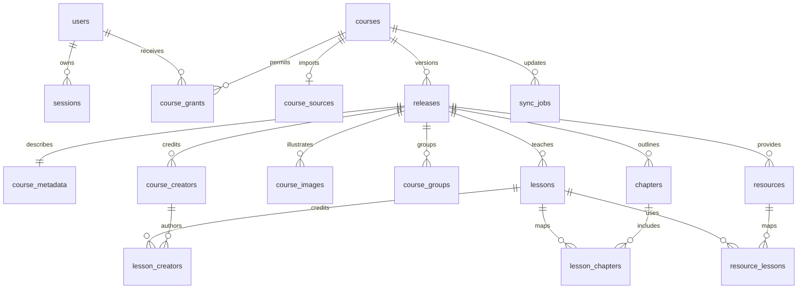

# 数据与 API 约定

状态：数据库与接口的逻辑约定。首版已实现，实际迁移位于 `apps/courseware-api/migrations/`，接口契约为该仓库导出的 `openapi.json`，由 `apps/courseware-web` 生成类型后消费。本文采用 PostgreSQL UUID 主键和 UTC `timestamptz`，对外时间使用 ISO 8601。实际字段与逻辑约定的简化见[开发与交付说明](development.md)。

## 1. 关系模型



`courses` 保存稳定身份和平台策略，`releases` 保存一次发布的不可变内容。章节/课时的文本 ID 在单门课程内稳定，每次发布以 `(release_id, id)` 保存快照；不可把一次更新缺失的课时误删到其他版本。

| 表 | 主要字段 | 约束与职责 |
| --- | --- | --- |
| `users` | id, username, password_hash, display_name, role, status, must_change_password, created_at, updated_at | username 规范化后唯一；role=admin/member，status=active/disabled；首版用户名限制为可规范化的 ASCII 标识，展示名可中文 |
| `sessions` | id, user_id, token_hash, created_at, last_seen_at, idle_expires_at, expires_at, revoked_at | token_hash 唯一，绝不保存明文会话 token；CSRF token 由会话 ID 和服务端专用密钥派生；用户禁用/改密可批量撤销 |
| `courses` | id, slug, listing_status, access_policy, display_order, featured, current_release_id, published_at, created_at | slug 唯一且固定；listing_status=listed/unlisted；access_policy=authenticated/restricted |
| `course_sources` | course_id, repo_url, branch, manifest_path, credential_ref, enabled, updated_at | 一课一源，course_id 主键；manifest_path 首版固定 course.json；凭据仅存引用 |
| `course_grants` | course_id, user_id, granted_by, created_at | `(course_id,user_id)` 唯一；仅限制内容阅读，不授予管理权限 |
| `sync_jobs` | id, course_id, requested_by, trigger, status, stage, source_snapshot, commit_sha, release_id, idempotency_key, lease_owner, lease_expires_at, heartbeat_at, error_code, error_message, created_at, started_at, finished_at | trigger=cli/admin；status=queued/running/succeeded/failed；source_snapshot 是入队时不含凭据值的配置 JSONB；错误输出脱敏 |
| `releases` | id, course_id, source_snapshot, commit_sha, schema_version, validator_version, manifest_hash, manifest_json, artifact_path, artifact_hash, status, revoked_at, serving_until, created_at, validated_at | status=staging/ready/failed；artifact_path 是后端内部相对存储键，不能由清单控制；manifest_json 为 JSONB |
| `release_files` | release_id, path, sha256, size_bytes, media_type | `(release_id,path)` 唯一，鉴权文件服务查询此清单，不能任意拼接文件路径 |
| `course_metadata` | release_id, title, summary, description, language, level, tags, entry | release_id 主键；tags 为可索引文本数组；仅内容字段 |
| `course_images` | release_id, id, role, path, alt, width, height, position | `(release_id,id)` 主键；每个版本一张 cover，width/height 由实际文件验证/补全 |
| `course_creators` | release_id, id, name, roles, organization, team, bio, avatar_path, avatar_alt, position | `(release_id,id)` 主键；跨版本署名快照，不与 users 自动关联 |
| `course_groups` | release_id, id, title, summary, position | `(release_id,id)` 主键；一课至少一组 |
| `chapters` | release_id, id, parent_id, title, summary, position | `(release_id,id)` 主键；父节点限定同一版本 |
| `lessons` | release_id, id, group_id, kind, title, summary, status, entry, keywords, duration_minutes, cover_image_id, position | `(release_id,id)` 主键；发布课时入口必填，计划课时入口为空 |
| `lesson_chapters` | release_id, lesson_id, chapter_id | 三字段联合唯一，两个外键都包含 release_id |
| `lesson_creators` | release_id, lesson_id, creator_id, position | 三字段联合唯一；制作人顺序来自清单 |
| `resources` | release_id, id, title, kind, path, position | `(release_id,id)` 主键；下载实际文件需在 release_files |
| `resource_lessons` | release_id, resource_id, lesson_id | 三字段联合唯一，空关联表示课程级附件 |
| `audit_events` | id, actor_user_id, action, course_id, release_id, job_id, details, created_at | 记录账号/授权/来源配置变更、发布、回退和撤销；details 不含凭据 |

必须有的约束：

- `courses.current_release_id` 对 `(course_id, release_id)` 的组合外键，保证指向自己的版本；服务层只允许激活 ready、完整且未撤销的版本。
- 分组、章节、课时、制作人和图片的关联外键全部带 release_id，防止不同版本数据混用。
- 同课程 queued/running 任务使用部分唯一索引防止并发，Worker 领取用 `FOR UPDATE SKIP LOCKED`；发布/回退/清理还需统一课程锁。
- 内容去重键是 `(course_id, commit_sha, manifest_hash, validator_version)`；失败版本可原位重试准备，但已就绪快照不可修改。
- 所有 position 保存数组顺序；schema 中稳定 ID 不承担排序。删除用户首版使用 disabled，保留审计关联。

制作人首版按各发布版本保存；跨课筛选以稳定作者 ID 关联，避免导入一门课修改另一门课的署名。不预建机构/作者账号系统。需要独立作者主页、身份认证时再建立受管理的主体表。

## 2. 统计与搜索

首版统计直接由当前发布版本的关系表计算，课程规模尚小时不额外保存容易失真的冗余计数。DTO 返回：

```json
{
  "chapter_count": 9,
  "section_count": 9,
  "group_count": 2,
  "lesson_count": 9,
  "planned_lesson_count": 0,
  "resource_count": 3,
  "lesson_counts_by_kind": {"theory": 6, "lab": 3, "project": 0, "reading": 0},
  "known_duration_minutes": 0,
  "lessons_without_duration": 9
}
```

未提供时长不意味着课程时长为 0，前端必须根据 `lessons_without_duration` 展示“未提供”或“部分课时已知”。列表 `total` 是本次过滤条件下的可见课程数；平台总体统计另行查询，二者不得混用。

B-tree 索引用于 slug、用户、外键、任务状态、当前版本、类型和顺序；tags 用 GIN；标题/摘要等子串搜索按实际查询启用 `pg_trgm` GIN。可使用 SQL 视图联合当前版本的课程、作者、章节、已发布课时，首版不建设异步搜索索引。

检索先限定可见课程及 current_release_id，再匹配字段，最后计数、排序、分页。关联多个课时/作者时按课程 ID 去重，不能让一门课程占多条课程结果。短中文查询采用有边界的参数化子串匹配；对 `%` 和 `_` 转义，不把它们默认为用户可控通配符。

## 3. 前端数据契约

所有列表返回 `{ "items": [], "page": 1, "page_size": 20, "total": 0 }`；page 从 1 开始，page_size 默认 20、最大 100。空结果为 200。查询 q 最长 100 字符；排序枚举白名单，不接收 SQL 字段名或表达式。

所有课程 DTO 带 `slug`、`release_id`、`published_at`。CourseCard 包含标题、摘要、语言、等级、标签、cover（url/alt/width/height）、制作人摘要、统计、detail_url 和 launch_url。普通 DTO 不含 repo_url、branch、credential_ref、原始清单、文件系统路径或同步日志。

CourseDetail 在 CourseCard 基础上包含 description、gallery、完整 creators、groups、chapters、lessons 和 resources。每个课时含稳定 id、group_id、chapter_ids、creator_ids、kind、状态、摘要、关键词、可选时长和 URL。planned 课时的 URL 为 null。每项内容 URL 固定到该 DTO 的 release_id，保证同一页面内的元数据和文件一致；另外提供稳定 launch_url 供收藏和外链，跳转时选择当前版本。

页面外显字段不得泄露实现细节，例如 commit SHA 默认仅管理员见。平台数据保留扩展空间不意味着将原始数据库记录全部返回。

## 4. API 边界

| 方法与路径 | 权限 | 行为 |
| --- | --- | --- |
| `GET /api/v1/auth/csrf` | 匿名/登录 | 返回当前浏览器 CSRF 上下文；匿名上下文短期有效、与登录来源校验配合 |
| `POST /api/v1/auth/login` | 匿名 + 来源/CSRF 校验 | username/password，设置新会话 Cookie，返回当前用户与新 CSRF token |
| `POST /api/v1/auth/logout` | 登录 + CSRF | 撤销当前会话并清除 Cookie，204 |
| `GET /api/v1/auth/me` | 登录 | 用户 id、展示名、角色及有效会话的 CSRF token，no-store |
| `PUT /api/v1/auth/password` | 登录 + CSRF | current_password/new_password；撤销该用户所有会话，要求重新登录 |
| `GET /api/v1/courses` | 登录 | q、tag、creator_id、kind、page、page_size、sort；返回 CourseCard 列表 |
| `GET /api/v1/courses/{slug}` | 课程可见 | 当前 CourseDetail，可含计划课时目录 |
| `GET /api/v1/courses/{slug}/lessons` | 课程可见 | 按 group_id/chapter_id/kind/status 筛选与分页，保留发布顺序 |
| `GET /api/v1/search` | 登录 | q、type=course/lesson；按指定类型返回独立结果列表，课时结果只含 published |
| `GET /api/v1/catalog/facets` | 登录 | 返回当前用户可见内容的 tags、creators、kinds 及课程计数；作者 ID 不以姓名替代 |
| `GET /api/v1/catalog/stats` | 登录 | 返回可见上架课程数、已发布课时总数等概览 |
| `GET/POST /api/v1/admin/users` | admin | 用户列表/创建账号；创建时设置初始密码并要求首次登录修改 |
| `PATCH /api/v1/admin/users/{id}` | admin | 修改展示名、角色、禁用/启用；不允许禁用或降级最后一个启用管理员 |
| `POST /api/v1/admin/users/{id}/reset-password` | admin | 重置密码并撤销会话，强制下次改密；新密码不写日志 |
| `GET/POST /api/v1/admin/courses` | admin | 管理列表/登记课程与仓库源，初始 unlisted、无当前版本 |
| `PATCH /api/v1/admin/courses/{id}` | admin | 修改上架、访问策略、排序推荐；已建 slug 不允许修改 |
| `PUT /api/v1/admin/courses/{id}/source` | admin | 更新 repo/branch/credential_ref，记录审计；不接受内容标题覆盖 |
| `GET/PUT /api/v1/admin/courses/{id}/grants` | admin | 查询/整体替换读者授权，支持版本条件避免覆盖并发修改 |
| `POST /api/v1/admin/courses/{id}/sync` | admin | 创建任务，202 返回 job_id；接受 Idempotency-Key |
| `GET /api/v1/admin/jobs/{id}` | admin | 阶段、状态、提交、错误、耗时，敏感日志脱敏 |
| `GET /api/v1/admin/courses/{id}/releases` | admin | 版本历史、当前状态、保留/撤销信息 |
| `POST /api/v1/admin/courses/{id}/activate` | admin | 指定 release_id、expected_current_release_id、reason；用于回退或重新激活 |
| `POST /api/v1/admin/courses/{id}/releases/{release_id}/revoke` | admin | 立即停止该版本访问；当前版本必须先切换或同时下架课程 |

所有管理写接口都需要 CSRF。首次改密用户只允许 me/password/logout，不允许查询课程。账号禁用、改密、角色变更和“保留最后一个管理员”检查使用事务处理；同一账号可有多个会话，独立用户身份不能存为进程全局变量。授权整体替换接口使用 ETag/If-Match 或等价版本条件，并在事务中核对。

首版 stable HTTP 文件入口详见架构文档，不把静态文件塞入 JSON API，也不允许 API 接收任意磁盘路径。缺失文件返回 404，退出登录后的直接下载返回 401。

统一错误结构：

```json
{
  "error": {
    "code": "COURSE_MANIFEST_INVALID",
    "message": "课时 t02 引用了不存在的章节 ch02",
    "details": [{"path": "lessons[1].chapter_ids[0]", "reason": "unknown_reference"}],
    "request_id": "..."
  }
}
```

约定：400 非法请求、401 未登录/会话失效、403 已登录但操作角色不足、404 无权看到的课程或不存在资源、409 更新冲突/已有活动任务、422 字段或清单校验失败、429 限流。内部异常返回不含堆栈和凭据的通用错误。Worker 校验失败反映在任务状态，创建任务的 HTTP 202 不表示发布成功。

## 5. 一致性与演进

列表/详情在同一次读取中选定 current_release_id，后续查询固定此版本；必要时使用事务快照避免读取中途切换。回退时原始 JSON、关系数据和搜索内容不重新生成，只改变当前指针。

首版没有平台个人学习进度表。现有课件 localStorage 不按用户隔离，不导入为个人成绩或进度。未来增加时，以 user_id/course_id/lesson_id 为稳定键，并单独处理课时删除和版本迁移。

课程内容契约与 HTTP API 分别版本化：`schema_version` 由 skill 仓库维护；HTTP 路径 `/api/v1` 由 API 仓库维护。web 发布必须与已部署 API 兼容，根仓库集成验收固定各仓库提交和镜像版本。
